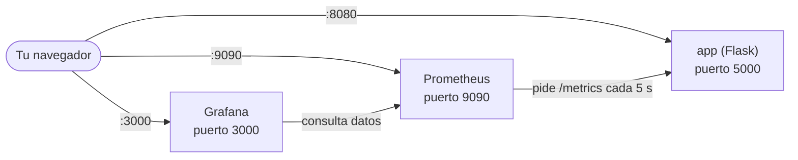

# Laboratorio DevOps: Flask + Prometheus + Grafana

Entorno local con **Docker Compose** para aprender monitorización. Levanta con **un solo comando** una aplicación web, un servidor que recoge sus métricas y un panel de gráficas para verlas.



| Servicio | Qué hace | Imagen |
|---|---|---|
| **app** | Web en Python (Flask) que expone sus métricas en `/metrics` | Construida desde `app/Dockerfile` (Python 3.11 Alpine) |
| **prometheus** | Pide las métricas a la app cada 5 segundos y las guarda | `prom/prometheus:latest` |
| **grafana** | Dibuja las métricas en paneles y gráficas | `grafana/grafana:latest` |

Los tres servicios comparten una red privada creada automáticamente por Docker Compose, y se encuentran entre sí por el nombre del servicio (`app`, `prometheus`, `grafana`).

---

## 1. Requisitos

Solo necesitas **Docker con Docker Compose** y **Git**.

| Sistema | Qué instalar |
|---|---|
| Windows / macOS | [Docker Desktop](https://www.docker.com/products/docker-desktop/) (incluye Compose) |
| Linux | [Docker Engine](https://docs.docker.com/engine/install/) y el plugin Compose |

Comprueba que todo está instalado:

```bash
docker --version
docker compose version
git --version
```

> **Importante:** en Windows y macOS, abre Docker Desktop y espera a que indique que está en marcha **antes** de ejecutar ningún comando.

Los puertos **8080**, **9090** y **3000** de tu ordenador deben estar libres. Si ya los usa otro programa, mira la sección [Solución de problemas](#7-solución-de-problemas).

No necesitas tener Python instalado: todo corre dentro de contenedores.

---

## 2. Puesta en marcha

### Paso 1. Descarga el proyecto

```bash
git clone <URL-DEL-REPOSITORIO>
cd f-devops-lab
```

Sustituye `<URL-DEL-REPOSITORIO>` por la dirección del repositorio (el botón verde **Code** de GitHub).

### Paso 2. Configura la contraseña de Grafana (opcional)

Copia el archivo de ejemplo:

```bash
# Linux / macOS / Git Bash
cp .env.example .env

# Windows (PowerShell)
Copy-Item .env.example .env
```

Abre `.env` y cambia la contraseña:

```
GRAFANA_USER=admin
GRAFANA_PASSWORD=pon_aqui_tu_contraseña
```

Si te saltas este paso, Grafana usará `admin` / `admin`, lo que está bien para un laboratorio local.

> El archivo `.env` **nunca se sube a GitHub** (está en `.gitignore`). Así tus datos quedan solo en tu ordenador.

### Paso 3. Arranca todo

```bash
docker compose up -d --build
```

- `up` crea y arranca los contenedores.
- `-d` los deja funcionando en segundo plano, y puedes seguir usando la terminal.
- `--build` construye la imagen de la app. La primera vez tarda uno o dos minutos porque descarga imágenes.

### Paso 4. Comprueba que está funcionando

```bash
docker compose ps
```

Deben aparecer tres contenedores con estado **running** (o **Up**): `contenedor-web`, `contenedor-prometheus` y `contenedor-grafana`.

---

## 3. Accesos

| Qué | Dirección | Para qué sirve |
|---|---|---|
| App web | http://localhost:8080 | Página de prueba "Hola desde mi contenedor Docker" |
| Métricas de la app | http://localhost:8080/metrics | Texto plano con las métricas que lee Prometheus |
| Prometheus | http://localhost:9090 | Consultar métricas y ver el estado de los *targets* |
| Estado de los targets | http://localhost:9090/targets | Comprobar que Prometheus llega a la app |
| Grafana | http://localhost:3000 | Paneles y gráficas |

Grafana pide usuario y contraseña. Usa los que pusiste en `.env`, o `admin` / `admin` si no creaste el archivo. En el primer acceso puede pedirte cambiar la contraseña; puedes saltar ese paso con *Skip*.

---

## 4. Comprueba que todo funciona

Sigue estos pasos en orden. Si todos salen bien, el laboratorio está operativo.

1. **La app responde.** Abre http://localhost:8080. Debe verse el mensaje de bienvenida.
2. **La app expone métricas.** Abre http://localhost:8080/metrics. Debe aparecer una lista larga de texto con líneas como `flask_http_request_total`.
3. **Prometheus ve a la app.** Abre http://localhost:9090/targets. Los dos *targets*, `flask-app` y `prometheus`, deben estar en **UP** (en verde).
4. **Prometheus tiene datos.** En http://localhost:9090, escribe `up` en el cuadro de búsqueda y pulsa **Execute**. Debe devolver dos filas con valor `1`.

---

## 5. Conecta Grafana con Prometheus y crea tu primer panel

Grafana arranca vacío. Hay que decirle de dónde sacar los datos.

### 5.1 Añadir Prometheus como Data Source

1. En Grafana, abre el menú de la izquierda: **Connections → Data sources**.
2. Pulsa **Add data source** y elige **Prometheus**.
3. En **Prometheus server URL** escribe exactamente:

   ```
   http://prometheus:9090
   ```

   > **No uses `localhost`.** Dentro del contenedor de Grafana, `localhost` es Grafana mismo. `prometheus` es el nombre del servicio en la red de Docker.

4. Baja al final de la página y pulsa **Save & test**. Debe aparecer un mensaje verde de éxito.

### 5.2 Generar tráfico

La app solo registra peticiones cuando alguien la visita. Abre http://localhost:8080 y recarga la página **15-20 veces** (`F5`).

### 5.3 Crear el panel

1. Menú izquierdo: **Dashboards → New → New dashboard → Add visualization**.
2. En **Data source**, elige `prometheus`.
3. Arriba a la derecha, cambia el rango de tiempo a **Last 5 minutes**. Con rangos largos, un laboratorio recién arrancado apenas muestra datos y parece que falla.
4. Pulsa en **Code** (junto a *Builder*), escribe una consulta de la tabla siguiente y pulsa **Run queries**.
5. Cuando te guste, pulsa **Save** y ponle un nombre al dashboard.

### Consultas útiles

| Qué muestra | Consulta | Visualización recomendada |
|---|---|---|
| Servicios levantados (1 = sí, 0 = no) | `up` | Stat |
| Total de peticiones recibidas | `sum(flask_http_request_total)` | Stat |
| Peticiones por segundo | `sum(rate(flask_http_request_total[1m]))` | Time series |
| Peticiones por código de respuesta (200, 404…) | `sum by (status) (flask_http_request_total)` | Bar chart |
| Latencia media (segundos) | `rate(flask_http_request_duration_seconds_sum[1m]) / rate(flask_http_request_duration_seconds_count[1m])` | Time series |

> Consejo: usa un panel por consulta. Si mezclas `up` (que vale 0 o 1) con valores pequeños como las peticiones por segundo, uno aplasta al otro.

---

## 6. Comandos del día a día

| Acción | Comando |
|---|---|
| Arrancar | `docker compose up -d` |
| Arrancar y reconstruir la app tras cambiar código | `docker compose up -d --build` |
| Ver el estado | `docker compose ps` |
| Ver los logs de todo (últimas 30 líneas) | `docker compose logs --tail 30` |
| Seguir los logs de un servicio en vivo | `docker compose logs -f app` (sal con `Ctrl+C`) |
| Parar sin borrar nada | `docker compose stop` |
| Parar y quitar los contenedores | `docker compose down` |
| **Borrarlo todo, incluidos los datos de Grafana** | `docker compose down -v` |

### ¿Se pierden mis dashboards al apagar?

| Acción | ¿Se conservan los dashboards de Grafana? |
|---|---|
| Apagar el ordenador o cerrar Docker | Sí |
| `docker compose stop` | Sí |
| `docker compose down` | Sí |
| `docker compose up -d --build` | Sí |
| `docker compose down -v` | **No** |
| `docker volume prune` | **No** |

Grafana guarda sus datos en un volumen de Docker llamado `grafana-data`. Solo se borra si lo pides explícitamente.

El histórico de métricas de Prometheus **no** se conserva al ejecutar `down`; vuelve a empezar de cero. Para un laboratorio no importa, y la configuración de Prometheus (`prometheus/prometheus.yml`) permanece intacta.

> **Contraseña de Grafana:** el valor de `GRAFANA_PASSWORD` solo se aplica la **primera vez** que se crea el volumen. Si cambias `.env` después, no tendrá efecto. Para aplicarlo, tendrías que empezar de cero con `docker compose down -v` y volver a arrancar (perderás los dashboards).

---

## 7. Solución de problemas

**`Cannot connect to the Docker daemon` / `docker: error during connect`**
Docker no está en marcha. Abre Docker Desktop y espera a que termine de arrancar.

**`port is already allocated` o `address already in use`**
Otro programa usa el puerto 8080, 9090 o 3000. Cierra ese programa, o cambia el número de la izquierda en `docker-compose.yml`. Por ejemplo, `"8081:5000"` hace que la web quede en http://localhost:8081.

**`docker compose` no se reconoce**
Tienes una versión antigua de Docker. Actualiza, o prueba con el comando antiguo `docker-compose` (con guion).

**El contenedor `contenedor-web` se cae al arrancar**
Mira el motivo con `docker compose logs app`. Si dice `ModuleNotFoundError: No module named 'prometheus_flask_exporter'`, falta la dependencia en `app/requirements.txt`. Debe contener:

```
Flask==3.0.3
prometheus-flask-exporter==0.23.1
```

Después ejecuta `docker compose up -d --build`.

**El contenedor `contenedor-prometheus` se cae al arrancar**
Mira `docker compose logs prometheus`. Casi siempre es un problema con `prometheus/prometheus.yml`: indentación incorrecta, tabulaciones en lugar de espacios, o contenido equivocado. El archivo debe empezar por `global:`. Guárdalo en codificación **UTF-8**.

**En Prometheus, el target `flask-app` aparece en DOWN**
La app no está funcionando. Revisa `docker compose logs app`.

**Grafana dice "No data"**
Prueba por orden:
1. Cambia el rango de tiempo a **Last 5 minutes**.
2. Visita http://localhost:8080 varias veces para generar peticiones.
3. Pulsa **Run queries**. En modo *Code*, escribir la consulta no basta.
4. Comprueba que el Data Source es `prometheus` y que su URL es `http://prometheus:9090`.

**Grafana muestra una gráfica con una línea aleatoria**
Está usando el Data Source de pruebas `-- Grafana --`. Cámbialo a `prometheus`.

**Quiero empezar de cero**
```bash
docker compose down -v
docker compose up -d --build
```

---

## 8. Estructura del proyecto

```
f-devops-lab/
├── docker-compose.yml       # Define los tres servicios y su configuración
├── .env.example             # Plantilla de variables (copiar a .env)
├── .gitignore               # Evita subir secretos y archivos temporales
├── README.md                # Este archivo
├── app/
│   ├── Dockerfile           # Receta para construir la imagen de la app
│   ├── app.py               # Aplicación Flask con las métricas activadas
│   └── requirements.txt     # Dependencias de Python
└── prometheus/
    └── prometheus.yml       # Qué debe vigilar Prometheus y cada cuánto
```

### Cómo funciona por dentro

- **`app/app.py`** crea una web con Flask. La librería `prometheus-flask-exporter` añade automáticamente la ruta `/metrics`, con contadores de peticiones, códigos de respuesta y tiempos.
- **`prometheus/prometheus.yml`** indica a Prometheus que cada 5 segundos pida las métricas a `app:5000`. Usa el puerto **interno** de la app (5000), no el 8080 que se ve desde tu navegador.
- **`docker-compose.yml`** conecta todo: construye la app, monta el archivo de configuración en Prometheus y guarda los datos de Grafana en un volumen.

---

## 9. Seguridad

- Este laboratorio está pensado para uso **local**. No lo expongas a Internet tal cual.
- El repositorio **no contiene credenciales**. La contraseña de Grafana sale de tu archivo `.env`, que Git ignora.
- Si lo usas en un entorno real, cambia `admin` / `admin` por una contraseña robusta.
- La app usa el servidor de desarrollo de Flask. Para producción se usaría un servidor como Gunicorn.
- Las versiones de Flask y del exportador están fijadas en `requirements.txt` para que el resultado sea el mismo hoy que dentro de unos meses.

---

## 10. Ideas para ampliar el laboratorio

- Provisionar el Data Source y los dashboards de Grafana con archivos, para que arranque ya configurado.
- Añadir un volumen a Prometheus para conservar el histórico de métricas.
- Añadir `node-exporter` para monitorizar el equipo, y `cAdvisor` para los contenedores.
- Crear alertas en Grafana o Alertmanager cuando la app deje de responder.
- Servir la app con Gunicorn detrás de Nginx.

---

Hecho como proyecto de ASIR.